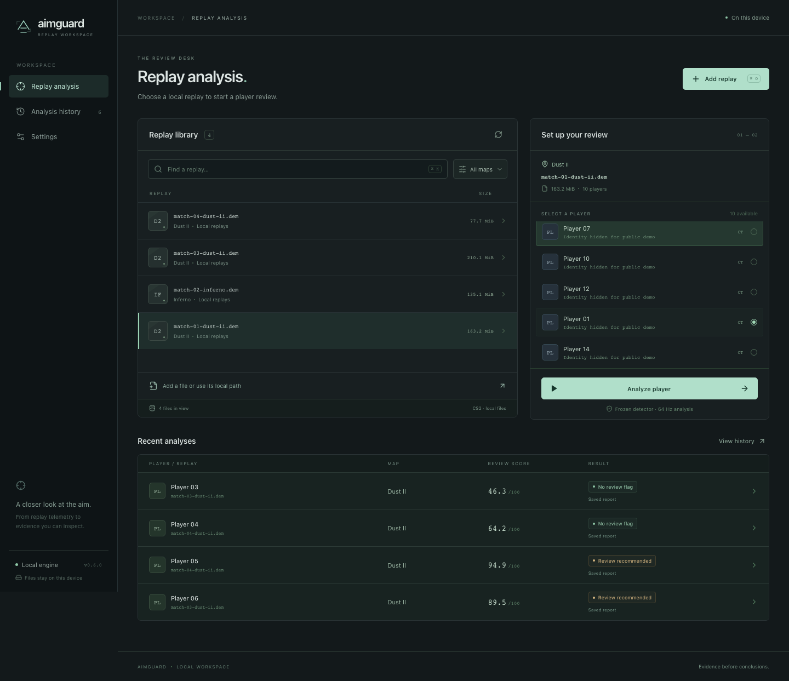
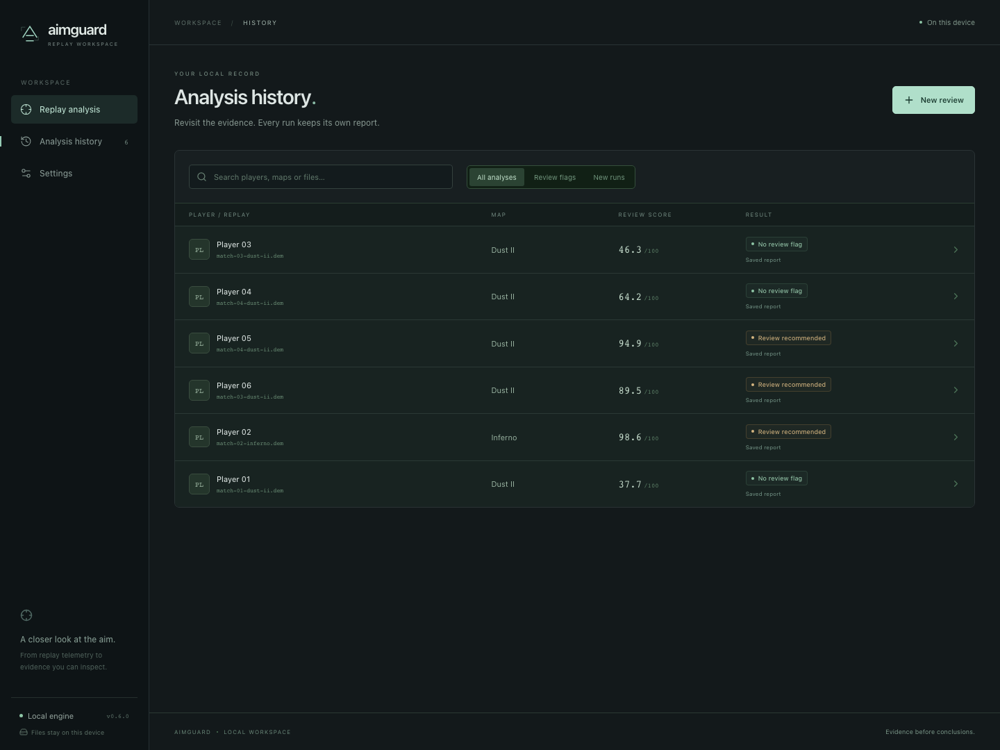
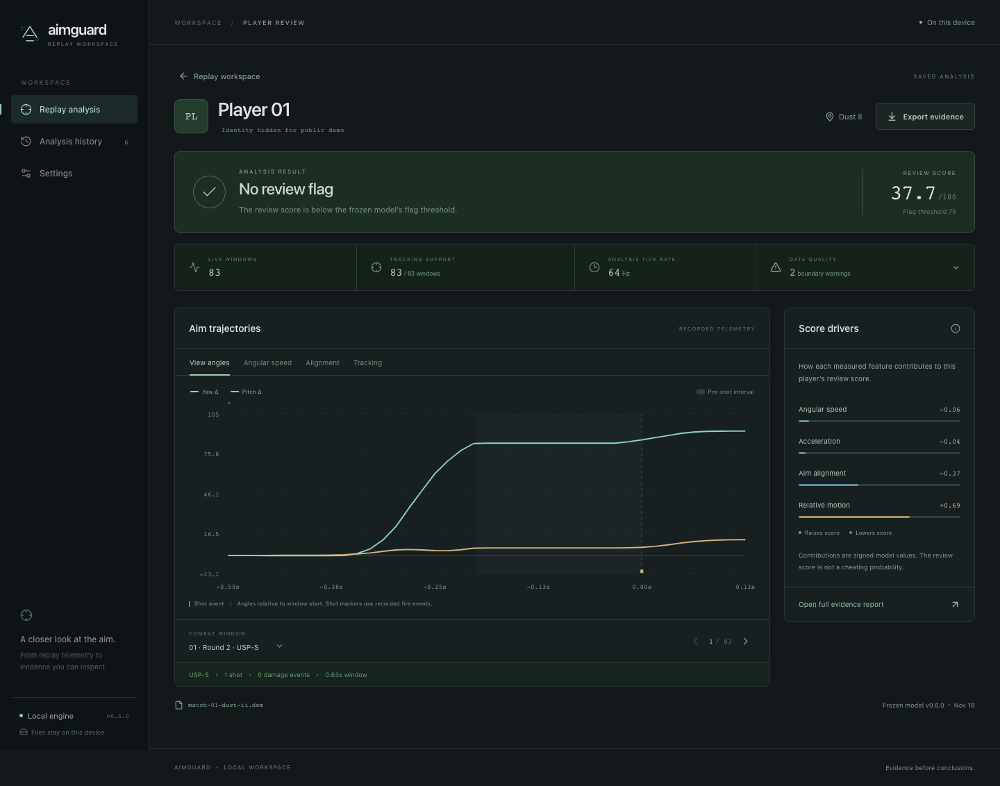
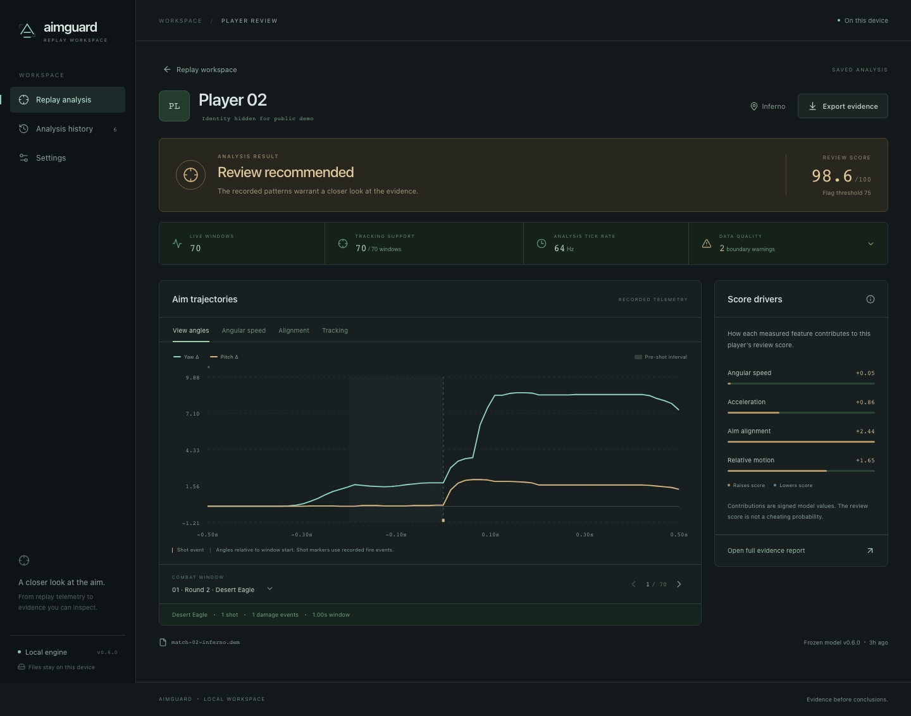

# AimGuard

An offline CS2 replay-analysis and aim-cheat detection research prototype. It checks server match-phase flags, segments active rounds and player lives,
matches player combat events, and describes view-angle movement around shots.
The local replay workspace lets you select a player, run the frozen v0.6 detector,
inspect aim trajectories and score contributions, and export the evidence.

## Install and run

The **trained model and built interface are included**. Bring your own 64 Hz
CS2 `.dem` recording; no CS2 installation, training step or Node.js is needed.

```sh
git clone https://github.com/varunmenon0/AimGuard.git
cd AimGuard
```

Use **Python 3.12.10 exactly**. With [uv](https://docs.astral.sh/uv/getting-started/installation/):

```sh
uv run --python 3.12.10 --no-project scripts/setup_local.py
.venv/bin/python scripts/launch_ui.py
```

Or run `python3.12 scripts/setup_local.py` using an installed Python 3.12.10.
On Windows, use `py -3.12 scripts/setup_local.py`, then
`.\.venv\Scripts\python.exe scripts\launch_ui.py`.
On macOS, you can double-click **Launch AimGuard.command** after setup.

Setup installs pinned detection dependencies, prepares the separate interface
environment, and verifies the bundled model. New installations start with an
empty replay library and history. See [full installation instructions](docs/INSTALL.md)
and [the included model card](artifacts/aimguard-v0.6/MODEL_CARD.md).

## Interface demo

Four screenshots from the running local interface. This curated workspace uses
real saved analyses; display names and filenames are pseudonymized and Steam
identities are hidden. Scores, decisions and curves are unchanged. The recordings
and saved reports shown here are not included in a clone.

**1. Replay workspace.** Choose a local recording and select a player.



**2. Saved review history.** Reopen completed analyses, including both review
flags and results below the review threshold. A non-flag is not a certification
of legitimate play.



**3. Legitimate-labeled example.** Player 01 scores **37.7/100**, below the fixed
75 threshold. The review includes 83 live combat windows and interactive curves.
This is an existing development example, not an additional test case.



**4. Cheating-labeled example.** Player 02 scores **98.6/100** and is flagged for
review. The source dataset supplies a generic cheating label; it does not confirm
that an aimbot was active in the displayed window.



## Open the local interface

After setup on macOS, double-click **`Launch AimGuard.command`** in the repository folder.
It opens the app in your browser at **http://127.0.0.1:8765**. Keep the launch
window open; press **Ctrl+C** there to stop the app.

1. Choose a replay from the library, or click **Add replay** to import a `.dem`
   file or use its existing local path.
2. Select a player and click **Analyze player**. The app reads the recording,
   builds combat windows, tracks opponent geometry and computes a review score.
   For a complete match, choose **Analyze all players** instead. It queues every
   human player and opens a saved summary with progress, flags, non-flags and
   unresolved results. Open each completed player’s evidence from that summary.
3. Inspect the result and switch between view angles, angular speed, alignment
   and tracking. Select another combat window or hover over a curve for values.
4. Use **Analysis history** to reopen a review, **Open full evidence report** for
   the detailed report, or **Export evidence** for a portable ZIP.

The app and all replay processing run on this computer. Saved analyses appear
automatically. The interface uses a separate `.ui-venv` and leaves the original
detector environment intact. The first launch installs interface dependencies;
later launches need no internet connection. Node.js is only needed to change the
interface source, not to run the included built interface.

From a terminal in the repository, the equivalent command is:

```sh
.venv/bin/python scripts/launch_ui.py
```

The packaged model is selected automatically in a fresh clone. See
[the interface guide](docs/LOCAL_INTERFACE.md) for storage,
troubleshooting, development and test commands.

## Research and development setup

The broad requirements below are for research and tests. For the delivered app,
use the pinned installer above. Keep the frozen inference environment separate.
Use Python 3.12. From a separate research checkout:

```powershell
py -3 -m venv .venv
.\.venv\Scripts\Activate.ps1
python -m pip install -r requirements.txt
python -m pytest -q
```

On macOS/Linux, use `python3 -m venv .venv` and `source .venv/bin/activate`.

## Score a player with a frozen model

With the installed runtime, score one player from a 64 Hz demo:

```sh
.venv/bin/python -m aimguard.offline_detector score artifacts/aimguard-v0.6 path/to/match.dem --steamid EXACT_STEAMID --output outputs/player-review
```

Open `outputs/player-review/result.html` for the decision, review-priority score,
coverage and trajectory-evidence link. `prediction.json` includes the four feature
values, their model contributions, warnings and source/model checksums.

Decisions are `flag_for_review`, `not_flagged`, or `insufficient_evidence`.
The score is uncalibrated; a flag requests review and a non-flag does not certify
legitimate play. Insufficient evidence is unresolved. Use a new output directory.

The compact inference model is bundled in Git. Replays, saved analyses and the
original research artifacts remain local. The model checks
its feature recipe, Python/dependency versions and source hashes before scoring.
See [the offline workflow](docs/OFFLINE_DETECTOR.md) for research model preparation and
single-use evaluation commands. Descriptive analysis below works without a model.

## Descriptive replay analysis

Replace the example path below with a recording on your computer. Replay files
are not bundled with the repository.

Find a player's SteamID with the existing diagnostic command:

```sh
python -m aimguard.cs2 data/raw/your-end-vs-damajuana-m1-cache.dem --list-players
```

Run the phase-checked firearm analysis:

```sh
python -m aimguard.phase_gameplay data/raw/your-end-vs-damajuana-m1-cache.dem --steamid 76561199104430312 --tickrate 64 --output outputs/v06/slender
```

Optional settings: `--pre-seconds 0.5`, `--post-seconds 0.5`,
`--shot-gap-seconds 0.5`, and `--max-plots 10`. Use `--max-plots 0` to skip plots.
Timing is an explicit assumption: verify the demo's tick rate before interpreting
rates or durations. No additional demo download or classifier training is needed.

Outputs:

- `telemetry.csv`: selected-player samples, including excluded rows, round and
  segment IDs, active flags, exclusion reasons, and recorded phase flags/status. Invalid angles are preserved
  as boundaries rather than removed and joined across. Angles are exported as
  float64 to preserve parser precision for derivative recalculation.
- `events.json`: selected-player shots, incoming/outgoing damage, and deaths,
  with explicit player roles and exact string SteamIDs. Segment `-1` means an
  event is outside a valid active segment.
- `report.json`: features for every published window, skipped groups and reasons,
  sample coverage, life-state verification, unusual round events, configuration,
  source SHA-256, feature version, and dependency versions.
- `engagement_XXXX.png`: close-up yaw, pitch, and speed plots with shot markers;
  plots are disabled by default; use `--max-plots 10` to create them. The report lists generated plots.
- `review.html`: local yaw/pitch/speed review with window and shot controls.

Generated data and outputs are ignored by Git. Use a separate output directory
for each player or configuration to keep analyses distinct.

## Segmentation rules

- Recorded samples must explicitly have warmup off and match-started on. Missing or
  conflicting flags are excluded. Missing required properties fail analysis. The
  gate runs before shot grouping and feature extraction; phase boundaries split
  segments and events outside those segments retain ID `-1`.
- `round_start` closes any preceding active interval and enters freeze time.
  `round_freeze_end` opens active play. `round_end` closes it; its tick is excluded.
  No freeze-end means that round is excluded. Events are not paired by list index.
- A freeze-end without a start opens a flagged inferred round. Duplicate
  freeze-ends are reported and ignored. Missing round ends close at the next
  start or recording end and are reported. For simultaneous transitions, an end
  is processed before a start, then a freeze-end.
- Life state `0` and positive health are required for alive samples. Known
  states `1` and `2` are excluded even when older demos retain positive health.
  Reports count these retained-health samples and include the state/health
  distribution. Positive health on playing teams with an unknown finite state
  fails verification. Other unknown or nonfinite samples are excluded.
- Only teams `2` and `3`, positive health, valid life state `0`, finite required
  telemetry, and pitch within [-90, 90] are eligible during active play.
- Victim death events exclude the death tick, even with delayed health updates.
  A death latch clears only after an observed non-alive to alive transition or
  a new active round. Killing another player does not end the selected player's life.
- Invalid samples, ineligible periods, round changes, and recording gaps over
  250 ms split segments. Duplicate ticks keep the last input observation using a
  stable sort. Unlocatable invalid tick values cause an error.

## Shot-centered windows and features

New analyses default to `--weapon-mode firearms`. The explicit firearm list
excludes knives, utility, tasers, and unknown/missing weapon names. Use
`--weapon-mode all` to include all weapon-fire events for diagnostics. Filtering
occurs before shot grouping, and weapon changes split groups. Each window records
its normalized weapon name. Reports record excluded event counts by weapon,
and events.json records the selection flag independently of active-life coverage.

Version 0.4 added `movement_context` alongside the existing full-window features.
`--near-shot-seconds` defaults to 0.1 seconds. A speed interval is near a shot
when its ending tick is within that radius of any grouped shot. Remaining
intervals are surrounding movement. Acceleration requires two consecutive speed
intervals in the same category, and jerk requires three. Disjoint periods are
never joined to calculate derivatives. Samples at category boundaries may
therefore contribute to full-window derivatives only. Empty categories report
null measurements and zero sample counts. Covered durations and counts are
included for interpretation.

This timing radius is configurable and has not been validated as a detection
threshold. Replay reviews shade near-shot periods and show both summaries.
Older reports still open with their original full-window measurements.

Version 0.5 adds `shot_time_profile` for each window. Every near-shot speed
interval references its nearest grouped shot; equal-distance ties reference the
earlier shot. Before, at, and after categories are disjoint. The profile includes
before/after p95 speed, at-shot median speed, a log1p before/after speed difference,
near-shot stop fraction, mean turn angle, axis reversal rates, and the signed
offset of the first near-shot speed peak. Stationary motion has no peak timing.
These are movement descriptions; target error and recoil are not reconstructed.

Direction features use adjacent intervals within near-shot periods. Axis
reversals require both steps to be at least 0.05 degrees. Turn angles require
nonzero adjacent yaw/pitch steps. Rates use covered near-shot duration, and
missing observations remain null. Review pages display these measurements
alongside their shot markers and original summaries.


Nearby selected-player `weapon_fire` events are grouped within each segment;
successive shots at most `--shot-gap-seconds` apart belong to one group.
Pre/post context is clipped to that segment. Groups with fewer than eight samples
or without samples bracketing their shots are explicitly skipped. Padded windows
from distinct groups may overlap; their statistics are not independent trials.

Each window contains mean/p95 angular speed, mean absolute speed acceleration,
p95 absolute speed jerk, path efficiency, mean turn angle (radians), speed CV, and
near-stop fraction (speed below 2 deg/s). Angular movement uses the Euclidean
yaw/pitch coordinate approximation, not mouse input or target-relative error.
Acceleration and jerk describe scalar speed changes, not vector acceleration.
Yaw wrapping and irregular sample intervals are handled by the extractor.

Two additional counts describe adjacent yaw/pitch steps reversing sign when both
steps are at least 0.05 degrees. These are descriptive reversal counts, not
verified aim corrections. Damage and kill event counts describe the selected
player's events inside the window, not causal attribution to a particular shot.

Weapon fire demonstrates shooting activity, not an encounter with a visible
enemy. Positions are retained for future context but visibility, enemy targeting,
weapon-specific recoil compensation, and target acquisition are not implemented.

## Other entry points

- `python -m aimguard.phase_batch jobs.json --output outputs/v06/batch` analyzes
  a JSON array of `{demo, steamid, tickrate}` jobs, isolates failures, and writes
  `summary.json`. Use a new output directory for each run.
- `aimguard.gameplay` and `aimguard.batch` retain the legacy v0.5 behavior for
  reproducing old results. They do not apply the new server-phase gate. v0.6
  reports have a distinct feature version and are rejected by v0.5 frozen models.
- `python -m aimguard.cs2 DEMO --steamid ID --output outputs/cs2` retains the older
  unfiltered whole-replay diagnostic workflow. Its fixed windows use absolute
  tick bins and one shared preceding sample to retain boundary movement. It
  does not apply gameplay filtering.
- `python -m aimguard.demo --output outputs/synthetic_report.json` retains the
  separate synthetic classifier smoke test. Its intentionally different synthetic
  styles and session split do not establish real-world detection performance.
- `scripts/inspect_demo.py` is the existing local property/event inspection script.

## License

[MIT](LICENSE) © 2026 Varun Menon.
